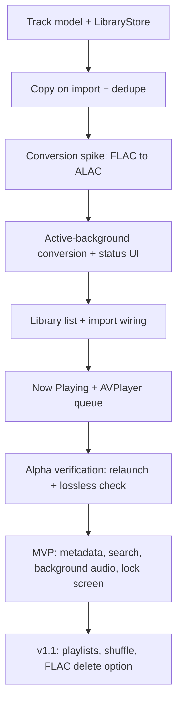

# FlacPlayer roadmap

Personal **iPhone** app: import **FLAC/ALAC** from **any Files location** (e.g. Dropbox), build a **standalone on-device library**, play through **ALAC** via AVFoundation after FLAC conversion.

## Phases

| Phase | Intent |
|--------|--------|
| **Alpha** | Dogfood build: end-to-end import → library → play on your device. Conversion may require the app to be **foreground/ active**. Not store-ready. |
| **MVP (v1.0)** | Something you’d put on **TestFlight / App Store**: background audio, rich library UI, stability and recovery bars below. |
| **v1.1** | Power-user convenience: playlists, shuffle/repeat, optional FLAC cleanup, playback position restore, queue editing. |

In the matrix below, **X** = **first phase where the feature must land**. Later phases **include** everything from earlier phases (features carry forward).

---

## Feature matrix

| Feature | Alpha | MVP (v1.0) | v1.1 |
|---------|:-----:|:----------:|:----:|
| **IMPORT & STORAGE** | | | |
| Import FLAC/ALAC from Files | X | | |
| Multi-file import | X | | |
| Persistent on-device library | X | | |
| FLAC → ALAC conversion | X | | |
| Background conversion while app is active | X | | |
| Duplicate detection | X | | |
| Conversion status and basic errors | X | | |
| Resumable/retryable conversions | | X | |
| Storage usage and cleanup | | X | |
| Optional deletion of original FLAC | | | X |
| **PLAYBACK** | | | |
| Play/pause | X | | |
| Seek/scrub | X | | |
| Previous/next track | X | | |
| Basic playback queue | X | | |
| Background audio | | X | |
| Lock-screen/Control Center controls | | X | |
| Audio interruptions handling | | X | |
| Album-ordered playback | | X | |
| Gapless playback | | X | |
| Playback position restoration | | | X |
| Shuffle and repeat | | | X |
| **LIBRARY & UI** | | | |
| Basic track list | X | | |
| Basic Now Playing screen | X | | |
| Track deletion | | X | |
| Embedded title/artist/album tags | | X | |
| Album and track-number organization | | X | |
| Embedded album artwork | | X | |
| Search by title/artist/album | | X | |
| Basic library sorting | | X | |
| Playlists | | | X |
| Queue editing/reordering | | | X |
| **RELEASE READINESS** | | | |
| Relaunch persistence test | X | | |
| Lossless conversion verification | X | | |
| Import/conversion failure recovery | | X | |
| No major playback/crash bugs | | X | |
| TestFlight beta testing | | X | |
| App Store distribution | | X | |

---

## Architecture (locked-in)

| Topic | Choice |
|--------|--------|
| Platform | iPhone only for now |
| Import | Document picker (`fileImporter`); Files / Dropbox folders |
| Persistence | **Copy into app container** on import (not long-lived bookmarks to external paths) |
| Duplicates | Dedupe on import (e.g. size + hash and/or stable source identity) |
| Formats | **FLAC** (convert) + **ALAC** (copy, play as-is) |
| Playable asset | **ALAC** on disk; **AVPlayer** (+ queue state) |
| Conversion UX | Copy FLAC on import → **prefetch ALAC** on a background queue while app can run work; play when `ready` or brief wait if user is early |

**Copy vs bookmark:** Bookmarks break when Dropbox or Files paths move or scoped access lapses. Copy-in matches a reliable phone-local library.

### Data flow

```
Import (security-scoped URL)
  → copy to Application Support/Library/...
  → LibraryStore (SwiftData or equivalent)
  → FLAC: enqueue conversion → ALAC in Playable storage
  → ALAC import: copy → ready

Playback (Alpha+)
  → play ALAC URL when conversionStatus == ready
  → queue: basic order in Alpha; album order + gapless in MVP
```

**Suggested layout**

- `Application Support/Library/Originals/` — FLAC (retain until v1.1 optional delete)
- `Application Support/Library/Playable/` — ALAC

**Track states:** `importing` → `converting` → `ready` | `failed` (Alpha: show status; MVP: retry/resume)

---

## Current status

**Pre-alpha:** Home → **Add Music** → document picker → in-memory file name list (lost when leaving the screen or quitting).

**Done when Alpha (per matrix):** All **Alpha** column items satisfied, including relaunch persistence and a lossless conversion sanity check.

---

## Alpha build order

Rough dependency order — not a second feature list; use the matrix for scope.



**Conversion spike (do early):** One test FLAC → ALAC in the sandbox → `AVPlayer` seek. Pick tooling after the spike (e.g. ffmpeg-kit vs decode/encode with Apple audio APIs); binary size and licenses matter for App Store MVP.

---

## Open items (decide while building)

1. **Skip intervals** for seek buttons (if any in Alpha): default ±15s unless you add explicit skip in matrix later.
2. **SwiftData vs Codable + files:** SwiftData helps MVP search and v1.1 playlists; either works for Alpha list.
3. **Deployment target** (currently iOS 26.x in the project): lower only if you care about older devices before App Store MVP.

---

## Out of scope (for now)

Multi-device sync, streaming from Dropbox without copy, AirDrop/share import (post–v1.1 candidate), real-time FLAC-only playback without ALAC cache, iPad/Mac targets, CarPlay.
